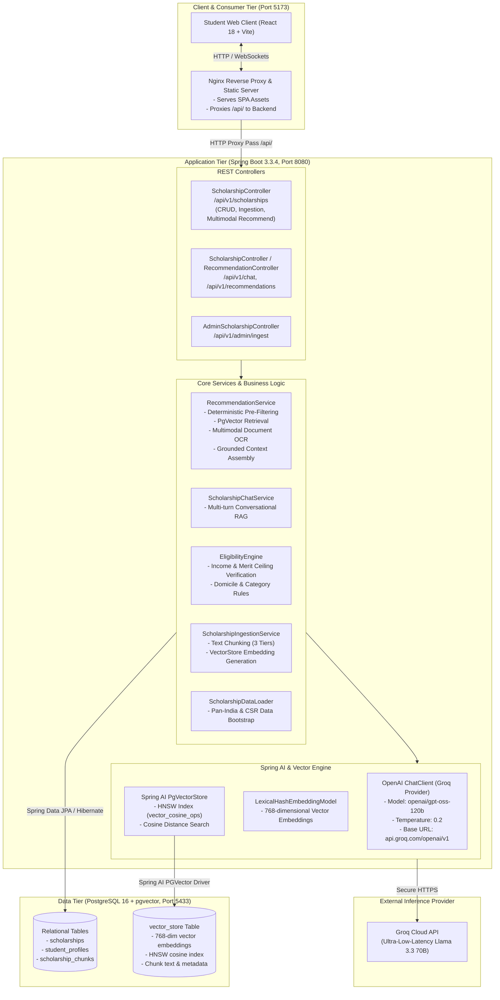

# Enterprise System Architecture

> **Note (2026-10-17):** parts of this page predate the current implementation. Where it conflicts with `README.md`, `docs/RAG_PIPELINE.md`, `docs/OPERATIONS.md` or `docs/LIMITATIONS.md`, those are correct. In particular: retrieval is keyword matching (not semantic), eligibility is evaluated in Java (`EligibilityEvaluator`), status is computed from verified dates, and the chat model is `openai/gpt-oss-120b` by default (`GROQ_MODEL`).

## 1. Architectural Overview

The **Enterprise AI Scholarship Platform** is a full-stack, production-grade recommendation and multi-agent RAG system designed for students across India. It matches students with central government, state government, and corporate CSR scholarship programs based on strict deterministic criteria and semantic natural language understanding.

---

## 2. Core Architectural Mandates

### A. Deterministic-First AI Pipeline
Vector similarity alone **does not determine eligibility**. A high semantic similarity score for a ₹10,000,000 scholarship does not mean a student with an income exceeding the ceiling can apply. 
- **Stage 1 (Deterministic SQL Query)**: Hard constraints (`maximum_family_income`, `minimum_marks_or_cgpa`, `eligible_states`, `category_requirements`, `gender_requirements`, `eligible_course`) are evaluated directly in PostgreSQL before context is passed to the LLM.
- **Stage 2 (Keyword Retrieval (lexical vectors))**: Spring AI `PgVectorStore` queries semantic chunks across the database using cosine similarity distance to identify contextual nuances (special reservations, specific sub-branches, disability perks).
- **Stage 3 (Grounded LLM Reasoning)**: The LLM receives strictly pre-filtered, verified candidates and produces clear explanations of *why* the student qualifies, the exact financial benefits, and mandatory document checklists.

### B. Decoupled Multi-Container Deployment
The platform is deployed via Docker Compose with three decoupled, isolated containers:
1. `db`: `ankane/pgvector:latest` running PostgreSQL 16 on internal port 5432, exposed on host port 5433.
2. `backend`: Java 21 Spring Boot 3.3.4 running in an `eclipse-temurin:21-jre-jammy` multi-stage container on port 8080.
3. `frontend`: React 18+ (Vite) built and served via `nginx:alpine` on port 5173, reverse-proxying `/api/` traffic to `backend:8080`.

### C. Zero Tech Clutter & Consumer-Centric Experience
The application is tailored for students and parents:
- All developer-facing badges, framework references (e.g. `pgvector`, `Spring Boot 8080 Live`, `Swagger API`, `Jsoup`, `Playwright`, `PDFBox`), and internal embedding dimensions are purged from the UI.
- Model names (such as `openai/gpt-oss-120b`) are strictly private and never exposed in API payloads or client labels.
- The visual design follows a dark aesthetic: Pure Black (`#000000`), Dark Charcoal (`#18181b`), and Electric Neon Orange (`#f97316` / `#ea580c`).

---

## 3. Technology Stack & Component Responsibilities

| Layer | Component | Version | Responsibility |
| :--- | :--- | :--- | :--- |
| **Frontend** | React + Vite | React 18.3, Vite 5.4 | Single Page Application, reactive state, UI components |
| **Styling & Motion** | Tailwind CSS + Framer Motion | Tailwind 3.4, Framer Motion 11 | Responsive dark-mode styling, staggered card animations |
| **Icons** | Lucide React | Latest | Consumer-facing icons (Rupee, Calendar, Check, Award) |
| **Web Server / Proxy** | Nginx | Alpine Latest | Serves static Vite dist assets and reverse-proxies API calls |
| **Backend Runtime** | Java OpenJDK | 21 LTS | High-performance enterprise runtime |
| **Framework** | Spring Boot | 3.3.4 | Dependency injection, MVC, REST APIs, scheduling |
| **AI Framework** | Spring AI | 1.0.0-M6 | ChatClient & VectorStore abstractions |
| **LLM Provider** | Groq (OpenAI Starter) | `openai/gpt-oss-120b` | Ultra-fast RAG generation and multi-turn student advisory |
| **Vector Store** | `spring-ai-pgvector-store` | 1.0.0-M6 | Vector storage, HNSW cosine index management |
| **Database** | PostgreSQL + pgvector | 16 (Ankane) | Relational persistence, JSONB metadata, 768-dim vectors |
| **Documentation** | Springdoc OpenAPI | 2.6.0 | Interactive Swagger UI at `/swagger-ui.html` |
