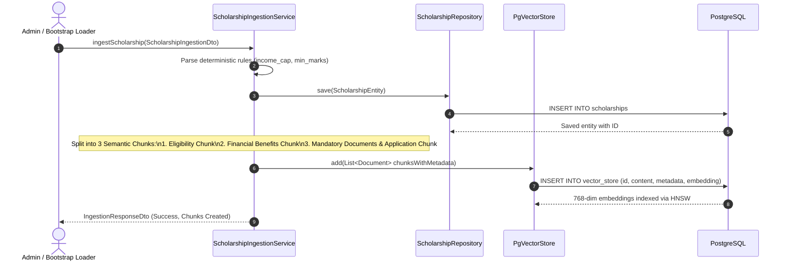

# Code Flow & End-to-End Request Lifecycle

> **Note (2026-10-17):** parts of this page predate the current implementation. Where it conflicts with `README.md`, `docs/RAG_PIPELINE.md`, `docs/OPERATIONS.md` or `docs/LIMITATIONS.md`, those are correct. In particular: retrieval is keyword matching (not semantic), eligibility is evaluated in Java (`EligibilityEvaluator`), status is computed from verified dates, and the chat model is `openai/gpt-oss-120b` by default (`GROQ_MODEL`).

## 1. Automated RAG Recommendation Request Flow

This sequence diagram depicts the complete execution flow when a student adjusts profile filters or submits a query in the frontend:

```mermaid
sequenceDiagram
    autonumber
    actor Student as Student (Web UI)
    participant UI as React 18 (EligibilityView)
    participant Nginx as Nginx Proxy (Port 5173)
    participant Ctrl as ScholarshipController (Port 8080)
    participant RecSvc as RecommendationService
    participant Repo as ScholarshipRepository
    participant DB as PostgreSQL (pgvector)
    participant VStore as PgVectorStore (Spring AI)
    participant Groq as Groq ChatClient (Llama 3.3 70B)

    Student->>UI: Adjusts Slider (e.g. Income ₹2.5L, 82% Marks)
    Note over UI: Debounces 350ms, injects hidden default RAG prompt
    UI->>Nginx: POST /api/v1/scholarships/recommend (multipart/form-data)
    Nginx->>Ctrl: Reverse Proxy to backend:8080/api/v1/scholarships/recommend
    Ctrl->>RecSvc: recommendMultimodal(query, income, marks, state, category, course)

    rect rgb(30, 30, 40)
        note right of RecSvc: Stage 1: Deterministic Filtering (Hard SQL Bounds)
        RecSvc->>Repo: EligibilityService.match(income, marks, state, category, course)
        Repo->>DB: SELECT * FROM scholarships WHERE income_cap >= ? AND marks_min <= ?
        DB-->>Repo: Returns verified candidate entities (e.g. 8 of 39 schemes)
        Repo-->>RecSvc: candidateList
    end

    rect rgb(40, 30, 30)
        note right of RecSvc: Stage 2: Keyword Ranking (Soft Nuances)
        RecSvc->>VStore: similaritySearch(query, topK = 10)
        VStore->>DB: SELECT content, metadata FROM vector_store ORDER BY embedding <=> query_vector LIMIT 10
        DB-->>VStore: Top semantic chunks
        VStore-->>RecSvc: retrievedChunks
    end

    rect rgb(30, 40, 30)
        note right of RecSvc: Stage 3: Grounded Context Assembly & LLM Generation
        RecSvc->>RecSvc: Assemble prompt with candidate IDs, chunks, and student parameters
        RecSvc->>Groq: call(groundedPrompt) [https://api.groq.com/openai/v1]
        Groq-->>RecSvc: Structured JSON (reasons, rupee benefits, document checklists)
    end

    RecSvc-->>Ctrl: MultimodalRecommendationResponseDto
    Ctrl-->>Nginx: 200 OK Response
    Nginx-->>UI: JSON Payload
    UI->>Student: Renders uniform equal-height cards in responsive CSS grid
```

---

## 2. Ingestion & 3-Tier Chunking Lifecycle

