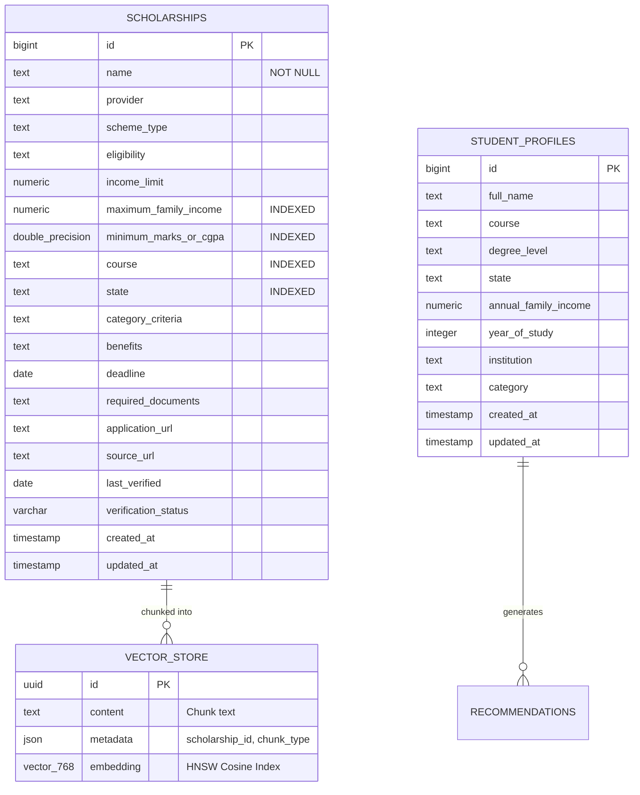

# Database Schema & Data Architecture (PostgreSQL + pgvector)

> **Note (2026-10-17):** parts of this page predate the current implementation. Where it conflicts with `README.md`, `docs/RAG_PIPELINE.md`, `docs/OPERATIONS.md` or `docs/LIMITATIONS.md`, those are correct. In particular: retrieval is keyword matching (not semantic), eligibility is evaluated in Java (`EligibilityEvaluator`), status is computed from verified dates, and the chat model is `openai/gpt-oss-120b` by default (`GROQ_MODEL`).

## 1. Overview

The platform uses **PostgreSQL 16** with the **`pgvector`** extension, containerized via `ankane/pgvector:latest` on host port `5433` (internal port `5432`).



---

## 2. Table Specifications

### 2.1 `scholarships` Table

Stores verified central, state, and CSR scholarship schemes:

| Column Name | SQL Type | Constraints | Description |
| :--- | :--- | :--- | :--- |
| `id` | `BIGINT` | `PRIMARY KEY`, Auto-Increment | Unique scheme identifier |
| `name` | `TEXT` | `NOT NULL` | Official name of the scholarship scheme |
| `provider` | `TEXT` | Nullable | Sponsoring body (e.g. DTE Maharashtra, Tata Trusts) |
| `scheme_type` | `TEXT` | Nullable | `State Government`, `Central Government`, `Corporate CSR` |
| `eligibility` | `TEXT` | Nullable | Full narrative text of eligibility rules |
| `income_limit` | `NUMERIC(12,2)` | Nullable | Gross income limit displayed to users |
| `maximum_family_income` | `NUMERIC(12,2)` | Nullable, **B-Tree Indexed** | Upper ceiling used for strict deterministic SQL filtering |
| `minimum_marks_or_cgpa` | `DOUBLE PRECISION`| Nullable, **B-Tree Indexed** | Academic percentage cutoff (e.g. `60.0` or `75.0`) |
| `course` | `TEXT` | Nullable, **B-Tree Indexed** | Applicable degrees / courses (e.g. `B.Tech`, `MBBS`) |
| `state` | `TEXT` | Nullable, **B-Tree Indexed** | Eligible domicile (e.g. `Maharashtra`, `All India`) |
| `category_criteria` | `TEXT` | Nullable | Caste / social groups (e.g. `General`, `OBC`, `SC`, `ST`) |
| `benefits` | `TEXT` | Nullable | Full details of tuition waivers, stipends, and grants |
| `deadline` | `DATE` | Nullable | Application deadline |
| `required_documents` | `TEXT` | Nullable | Comma-separated list of required certificates |
| `application_url` | `TEXT` | Nullable | Official application portal URL |
| `source_url` | `TEXT` | Nullable | Official government resolution / notification link |
| `last_verified` | `DATE` | Nullable | Date scheme criteria was last audited |
| `verification_status` | `VARCHAR(32)` | Nullable | `VERIFIED`, `PENDING_REVIEW`, `ACTIVE` |
| `created_at` | `TIMESTAMP` | Auto-Generated | Timestamp of record creation |
| `updated_at` | `TIMESTAMP` | Auto-Updated | Timestamp of last update |

### 2.2 `vector_store` Table

Managed by `spring-ai-pgvector-store` for storing semantic chunks and embeddings:

| Column Name | SQL Type | Constraints | Description |
| :--- | :--- | :--- | :--- |
| `id` | `UUID` | `PRIMARY KEY` | Unique chunk identifier |
| `content` | `TEXT` | `NOT NULL` | Text content of the semantic chunk |
| `metadata` | `JSON` / `JSONB` | Nullable | Contains `scholarship_id`, `chunk_type`, `scheme_name` |
| `embedding` | `VECTOR(768)` | `NOT NULL` | 768-dimensional vector embedding |

---

## 3. Database Indexes

To achieve sub-50ms deterministic query response times across large datasets, the following indexes are configured:

```sql
-- 1. Deterministic Rule Filtering Indexes (B-Tree)
CREATE INDEX idx_scholarships_income ON scholarships(maximum_family_income);
CREATE INDEX idx_scholarships_marks ON scholarships(minimum_marks_or_cgpa);
CREATE INDEX idx_scholarships_state ON scholarships(state);
CREATE INDEX idx_scholarships_course ON scholarships(course);

-- 2. HNSW Cosine Similarity Vector Index
CREATE INDEX idx_vector_store_embedding ON vector_store 
USING hnsw (embedding vector_cosine_ops)
WITH (m = 16, ef_construction = 64);
```


## Added columns and tables (2026-10-17)

`scholarships` gained nullable columns (added automatically, existing rows untouched): `open_date`, `deadline_verified_on`, `academic_year`, `last_checked`, `needs_review`, `review_reason`, `dedupe_key` (normalised name, used to prevent duplicates), `source_id` (registry id), `seed_hash`. `verification_status` may now also be `ARCHIVED_LEGACY`.

* `scholarship_deadline_history(id, scholarship_id, previous_deadline, deadline, academic_year, state APPLIED|PROPOSED, origin DATASET|ADMIN|SOURCE_CHECK, note, recorded_at)`
* `source_snapshots(source_id PK, url, organization, portal_name, last_checked, last_success, last_http_status, last_error, content_hash, last_change_detected, consecutive_failures)`
