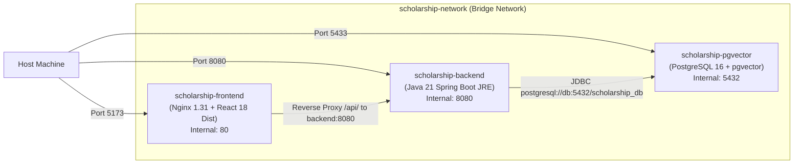

# Multi-Container Docker Deployment & Orchestration Guide

## 1. Multi-Container Orchestration Architecture

The entire platform is containerized for seamless, one-command deployment across three networked services:



---

## 2. Docker Compose Configuration (`docker-compose.yml`)

The root `docker-compose.yml` orchestrates the services:

```yaml
version: '3.8'

services:
  db:
    image: ankane/pgvector:latest
    container_name: scholarship-pgvector
    environment:
      POSTGRES_DB: scholarship_db
      POSTGRES_USER: postgres
      POSTGRES_PASSWORD: postgrespassword
    ports:
      - "5433:5432"
    volumes:
      - pgvector_data:/var/lib/postgresql/data
    healthcheck:
      test: ["CMD-SHELL", "pg_isready -U postgres -d scholarship_db"]
      interval: 5s
      timeout: 5s
      retries: 5
    networks:
      - scholarship-network

  backend:
    build:
      context: ./backend
      dockerfile: Dockerfile
    container_name: scholarship-backend
    environment:
      SPRING_DATASOURCE_URL: jdbc:postgresql://db:5432/scholarship_db
      SPRING_DATASOURCE_USERNAME: postgres
      SPRING_DATASOURCE_PASSWORD: postgrespassword
      GROQ_API_KEY: ${GROQ_API_KEY}
    ports:
      - "8080:8080"
    depends_on:
      db:
        condition: service_healthy
    networks:
      - scholarship-network

  frontend:
    build:
      context: ./frontend
      dockerfile: Dockerfile
    container_name: scholarship-frontend
    ports:
      - "5173:80"
    depends_on:
      - backend
    networks:
      - scholarship-network

volumes:
  pgvector_data:

networks:
  scholarship-network:
    driver: bridge
```

---

## 3. How to Configure or Change the Groq API Key

There are two primary ways to set or update the Groq API key:

### Method A: Environment Variable (Recommended)
Set the variable in your current terminal session before running Docker Compose:

```bash
# Windows PowerShell
$env:GROQ_API_KEY="<your-groq-key>"
docker compose up -d

# Windows Command Prompt (CMD)
set GROQ_API_KEY=<your-groq-key>
docker compose up -d

# Linux / macOS (Bash / Zsh)
export GROQ_API_KEY="<your-groq-key>"
docker compose up -d
```

### Method B: `.env` File
Create a `.env` file in the root directory (`E:\scholarship-rag\.env`):
```properties
GROQ_API_KEY=<your-groq-key>
```
Docker Compose automatically reads variables from `.env` in the current working directory.

---

## 4. Multi-Stage Dockerfile Specifications

### A. Backend Dockerfile (`backend/Dockerfile`)
Uses a two-stage build to compile with Maven and run on a lightweight Temurin 21 JRE image:
```dockerfile
# Stage 1: Build JAR
FROM maven:3.9.8-eclipse-temurin-21 AS build
WORKDIR /app
COPY pom.xml .
RUN mvn dependency:go-offline -B
COPY src ./src
RUN mvn clean package -DskipTests

# Stage 2: Minimal Production Runtime
FROM eclipse-temurin:21-jre-jammy
WORKDIR /app
RUN groupadd -r spring && useradd -r -g spring spring
COPY --from=build /app/target/scholarship-backend-1.0.0.jar app.jar
USER spring:spring
EXPOSE 8080
ENTRYPOINT ["java", "-XX:+UseG1GC", "-XX:MaxRAMPercentage=75.0", "-jar", "app.jar"]
```

### B. Frontend Dockerfile (`frontend/Dockerfile`)
Uses Node 20 to produce the production Vite bundle, then serves via Nginx Alpine:
```dockerfile
# Stage 1: Build Vite bundle
FROM node:20-alpine AS build
WORKDIR /app
COPY package*.json ./
RUN npm ci
COPY . .
RUN npm run build

# Stage 2: Serve via Nginx
FROM nginx:alpine
COPY nginx.conf /etc/nginx/conf.d/default.conf
COPY --from=build /app/dist /usr/share/nginx/html
EXPOSE 80
CMD ["nginx", "-g", "daemon off;"]
```

---

## 5. Deployment & Lifecycle Commands

### Start All Services (Detached & Build):
```bash
docker compose up -d --build
```

### Inspect Container Status & Health:
```bash
docker compose ps
```

### View Live Logs:
```bash
# Backend logs
docker compose logs -f backend

# Frontend logs
docker compose logs -f frontend

# Database logs
docker compose logs -f db
```

### Stop Services:
```bash
docker compose down
```

### Reset Volume (Full Database Wipe & Re-bootstrap):
```bash
docker compose down -v
docker compose up -d --build
```
